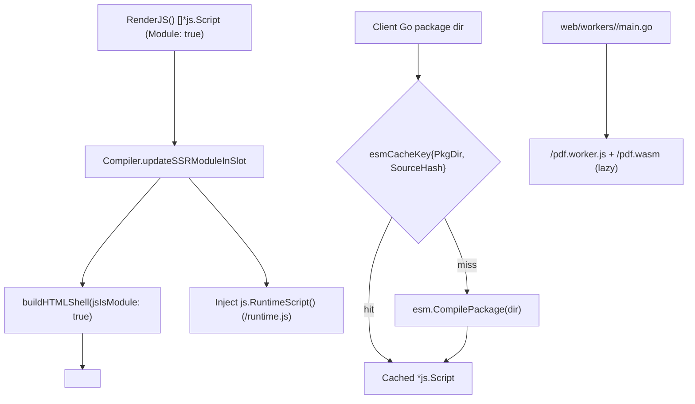

# Build-Time ESM Emission & Package Cache

How `webtyp/sitec` compiles strict-subset Go client packages via `webtyp/js/esm`, caches them by content hash, injects `runtime.js`, and emits `<script type="module">` with SRI under strict CSP.

1. Any provider returning `js.Script{Module: true}` activates ESM mode on `Compiler` and ensures `runtime.js` is emitted once.
2. `Compiler.CompileESMPackage(dir)` hashes the Go sources in `dir`, reuses cached ESM output on unchanged files, and recompiles via `webtyp/js/esm` on changes.
3. `buildHTMLShell` emits `<script type="module">` with `integrity="sha384-..."` and `crossorigin="anonymous"` (zero inline JS).
4. Lazy WASM Workers under `web/workers/` continue building independently (`/pdf.wasm` + `/pdf.worker.js`) without requiring `browser.wasm`.
