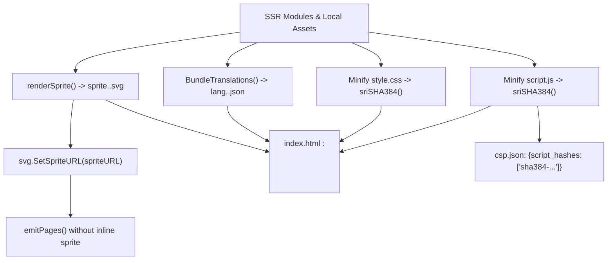

# Strict CSP Asset Pipeline (`sitec`)

Context: `sitec` emits an HTML shell free of inline `<script>`, `<style>`, `style=`, and `<svg>` so `server/httpd` can enforce a strict hash-based `Content-Security-Policy` with `require-trusted-types-for 'script'`.

## Walkthrough

1. Merged SVG symbols render as `<svg xmlns="http://www.w3.org/2000/svg">...</svg>` into an external hashed artifact `sprite.<hash>.svg` and `svg.SetSpriteURL` points SSR pages to it.
2. Merged translations JSON writes into `lang.<hash>.json` (no `<script type="application/json">` in HTML).
3. Final minified CSS and JS bytes are hashed with SHA-384 (`sha384-<base64>`), written as `integrity="..." crossorigin="anonymous"` in `index.html`, and the script hash is emitted to `csp.json` for `server/httpd`.
